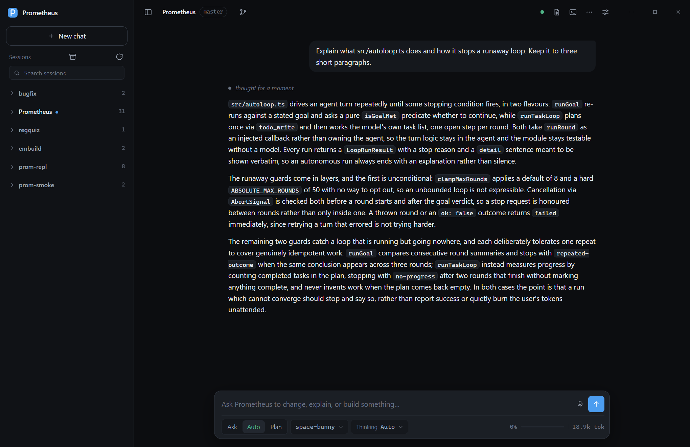

# Prometheus
> 通用终端编程代理 —— 连接任意 OpenAI 兼容接口，在仓库中直接干活。

A general-purpose terminal coding agent, with a desktop app. It talks to any
OpenAI-compatible `/chat/completions` endpoint, streams responses, and works on
your repository through a small, explicit tool set.

```
prometheus "add input validation to src/parser.ts"
npm run desktop          # the same agent in a window
```



## Desktop app

```bash
npm install              # installs Electron
npm run desktop
```

The window opens on the current directory; click the workspace chip to switch
folders. Modes and models sit under the composer, sessions live in the drawer,
and tool calls appear inline with expandable output. Packaging is configured for
electron-builder (`npm run build`) into NSIS/portable, dmg, and AppImage/deb.
See [desktop/README.md](desktop/README.md) for the host protocol.

Pass a folder to a packaged build to open it there:

```bash
Prometheus.exe D:\code\my-project
```

### The window

- **Changes pane.** Every file the agent touched is listed with `+N −N`. Click
  one to open a line diff in the right-hand workbench.
- **History pane.** Each write/edit is checkpointed before it runs; restore one
  step or everything back to the start of the session.
- **Terminal pane.** A persistent shell in the workspace, kept open across
  commands, with its working directory reflected in the prompt.
- **Git bar.** Branch, ahead/behind, and a commit box that stages and commits.
- **`@` references.** Type `@` in the composer to insert a workspace path.
- **Queued messages.** Text sent while a turn is running is delivered at the
  next tool boundary instead of being rejected.
- **Notifications.** Long turns and permission prompts raise a desktop
  notification when the window is not focused.

## What it does

- **Streaming chat with tool use.** The model reads files, edits them, searches
  the tree, and runs shell commands, then loops until the task is done.
- **Three permission modes.** `ask` confirms every mutating tool, `auto` runs
  them but still prompts for `confirm`-class shell commands, `plan` only allows
  read-only tools so you can investigate before changing anything.
- **Command sandbox.** Commands are classified (allow / confirm / deny), paths
  outside the workspace are refused, the environment is scrubbed of secrets, and
  network access can be cut off. It is a policy check, not an OS-level sandbox.
- **Rewind.** Any user turn can be rewound to: later turns are dropped and the
  files they changed are restored.
- **Resilient edits.** `edit_file` tolerates CRLF, trailing whitespace, and
  indentation drift, and accepts atomic batches or SEARCH/REPLACE patches.
- **Context that survives long sessions.** Three progressive compaction levels
  (trim oldest turns, then a deterministic recap, then clipping oversized tool
  output) keep a conversation inside the window without an extra model call.
- **Sessions.** Every conversation is saved as an append-only JSONL transcript
  under `~/.prometheus/sessions/<id>/` and can be resumed with `-r <id>`.
- **Sub-agents.** The `delegate` tool runs a self-contained task in a fresh
  context and returns only the report, keeping the main conversation lean.
- **Memory.** The `remember` tool persists durable facts about you and the
  project; they are injected into the system prompt on the next session.
- **Project instructions.** `PROMETHEUS.md`, `AGENTS.md`, or `CLAUDE.md` in the
  workspace is loaded into the system prompt automatically.
- **Audit log.** Every permission decision is appended to
  `~/.prometheus/audit.log`.
- **Custom commands.** Markdown files in `.prometheus/commands/` become slash
  commands in the composer (see `.prometheus/commands/review.md`). Prompts
  advertised by MCP servers join the same list.
- **Rules.** Markdown files in `~/.prometheus/rules/` or `.prometheus/rules/`.
  A rule with `paths:` globs (e.g. `src/web/**`) is only injected once the
  conversation touches a matching file; an unscoped rule always applies.
- **MCP servers.** Stdio and Streamable HTTP servers listed in
  `~/.prometheus/mcp.json` (user scope) or `<workspace>/.prometheus/mcp.json`
  (project scope, overrides by name) contribute their tools to the agent:

  ```json
  {
    "servers": {
      "files": { "command": "npx", "args": ["-y", "@modelcontextprotocol/server-filesystem", "."] },
      "remote": { "url": "https://mcp.example.com/mcp", "headers": { "Authorization": "Bearer ..." } }
    }
  }
  ```

## Architecture

The runtime is six layers, each with one job:

| Layer | Module | What it owns |
| --- | --- | --- |
| Main loop | `src/query.ts` | One async-generator state machine: compact → request → stream → tools. Yields events; never touches a UI. |
| Errors | `src/errors.ts` | Two-level classification: recoverable (retry with backoff) vs terminal (end the turn). |
| Model access | `src/providers.ts` | Declarative provider registry over one OpenAI-compatible adapter. No protocol fallbacks, no OAuth. |
| Context | `src/context.ts` | Three-level progressive compaction: trim locally, summarize with the session model, then clip. Falls back to the local summary on any failure. |
| Tools | `src/tools/pipeline.ts` | Five-stage pipeline: resolve → guard → prepare → execute → settle. |
| MCP | `src/mcp.ts` | stdio + Streamable HTTP transports, user/project scopes. |
| Sessions | `src/sessions.ts` | Append-only JSONL, one generation file per compaction, legacy files migrate on write. |

`src/agent.ts` wires those together with the conversation, permissions, hooks,
sub-agents, and the terminal UI. `desktop/host.js` drives the same `Agent`
through the desktop event protocol.

## Headless use

For scripts and CI, `--output-format` swaps the terminal renderer for one that
emits objects. `stream-json` prints one JSON line per event as it happens, so a
consumer can render progress without waiting for the turn to end.

```bash
prometheus --output-format json "summarise the changes on this branch" | jq -r .text
prometheus --output-format stream-json --mode auto "run the tests and fix what fails"
prometheus --max-budget-usd 0.50 "refactor src/context.ts"
```

`--output-schema schema.json` checks the final answer against a JSON Schema and
reports `schemaValid` rather than failing the run, so a caller can retry with a
better prompt. In headless mode a tool that would prompt is refused with a
readable reason instead of blocking on a terminal that is not there.

## Requirements

- Node.js 22.6 or newer (uses built-in TypeScript type stripping, so there is no
  build step and no runtime dependencies)
- An OpenAI-compatible endpoint and API key

## Install

```bash
git clone <this repo> prometheus
cd prometheus
npm link          # makes `prometheus` available on PATH
```

Or run it directly without linking:

```bash
node bin/prometheus.js "explain src/context.ts"
```

## Configure

Put the endpoint and key in `~/.prometheus/config.json`:

```json
{
  "baseUrl": "https://api.openai.com/v1",
  "apiKey": "sk-...",
  "model": "glm-5.3-flash"
}
```

Or name a provider from the registry and let it supply the base URL:

```json
{ "provider": "deepseek", "apiKey": "sk-...", "model": "deepseek-chat" }
```

Built-in providers live in `src/providers.ts` (OpenAI, DeepSeek, Moonshot,
Qwen, Ollama, OpenRouter). Add your own in `~/.prometheus/providers.json`:

```json
{ "providers": [{ "id": "company", "label": "Company gateway", "baseUrl": "https://ai.example.com/v1", "apiKeyEnv": ["COMPANY_AI_KEY"] }] }
```

Environment variables override the file: `PROMETHEUS_BASE_URL`,
`PROMETHEUS_API_KEY` (or `OPENAI_API_KEY`), `PROMETHEUS_MODEL`,
`PROMETHEUS_PROVIDER`. A project can override settings in
`.prometheus/config.json`.

The model picker offers whatever the endpoint advertises on `GET /models`, and
auto-discovery is cached for an hour (`~/.prometheus/models-cache.json`). Set
`PROMETHEUS_MODELS=glm-5.3-flash,deepseek-v4.1-flash` to restrict the list to
those ids.

`~/.prometheus/` supports a few more files:

| File                | Purpose                                     |
| ------------------- | ------------------------------------------- |
| `instructions.md`   | Global instructions injected into every run |
| `memory/global.md`  | User-level memory written by `remember`     |
| `memory/<hash>.md`  | Per-project memory                          |
| `audit.log`         | Permission decision log                     |

## Usage

Interactive REPL:

```bash
prometheus
```

One-shot:

```bash
prometheus --mode plan "how does the permission system work?"
prometheus --mode auto "fix the failing test in tests/core.test.ts"
```

| Flag | Meaning |
| --- | --- |
| `-m, --model <name>` | Model id |
| `--base-url <url>` | OpenAI-compatible base URL |
| `--key <key>` | API key |
| `--mode <ask\|auto\|plan>` | Permission mode |
| `-r, --resume <id>` | Resume a saved session |
| `--output-format <fmt>` | `text` (default), `json`, or `stream-json` |
| `--output-schema <file>` | Check the final answer against a JSON Schema |
| `--max-budget-usd <n>` | Stop between turns once the run has spent this much |
| `--max-tokens <n>` | Per-response cap (default 16000) |
| `--context-window <n>` | Compaction threshold (default 1,000,000) |
| `--max-turns <n>` | Tool-loop cap per message (default 60) |

### REPL commands

`/help`, `/model [name]`, `/mode [ask|auto|plan]`, `/plan`, `/yolo`, `/clear`,
`/compact`, `/cost`, `/context`, `/sessions`, `/resume <id>`, `/memory`,
`/init`, `/exit`. End a line with `\` to continue it. Esc interrupts a running
turn.

## Tools

| Tool | Purpose |
| --- | --- |
| `read_file` | Numbered lines, with offset/limit and a binary-file guard |
| `write_file` | Create or overwrite a file |
| `edit_file` | Match ladder (exact → whitespace → indent → anchor), multi-edit and SEARCH/REPLACE patches, atomic per call |
| `list_files` | Shallow tree view |
| `glob` | Find files by pattern (`**/*.ts`, brace expansion) |
| `grep` | Content search; uses ripgrep when installed |
| `search_codebase` | Rank files by declarations and keywords from a cached workspace index |
| `bash` | Shell commands with timeout, output cap, and the sandbox policy |
| `todo_write` | Maintain the visible task plan |
| `remember` | Persist a durable fact |
| `delegate` | Run one sub-agent, up to four in parallel with `prompts`, or with `background: true` |
| `mcp_read_resource` | Read a resource an MCP server advertises (present only when a server has one) |

All file tools resolve paths and refuse anything outside the workspace (plus
`allowedDirs` from config). Shell commands are classified by `src/sandbox.ts`:
destructive commands are denied, risky ones raise a confirmation, and the rest
run. Permission choices can be saved as persistent rules.

Two rules sit above every saved approval. **Protected paths** — `.git`,
`.vscode`, `.idea`, `.prometheus`, `.mcp.json`, and shell profiles — ask in every
mode, including `auto`, because editing them changes how the agent itself runs.
**Critical commands** — deleting the workspace root, the home directory, or a
drive root — are refused outright; no saved approval can authorise them.

## Design notes

The runtime is a loop, not a framework: `src/agent.ts` streams one assistant
turn, executes every requested tool call, appends the results, and repeats until
the model stops calling tools. Everything else is a plain module around that
loop.

```
bin/prometheus.js    entry point, CLI parsing, one-shot vs REPL
src/agent.ts         the loop, tool dispatch, sub-agents (parallel delegate)
src/llm.ts           OpenAI-compatible streaming client
src/fallback.ts      per-request model fallback for model-level failures
src/permissions.ts   modes, approval prompts, path confinement, audit log
src/rules.ts         persistent approval rules (glob, user/project scope)
src/sandbox.ts       command classification, path confinement, env scrub
src/codeIndex.ts     cached workspace index behind search_codebase
src/context.ts       token estimate and compaction
src/ui.ts            terminal rendering
src/render.ts        markdown-to-terminal formatting
src/tools/           the tool implementations
src/sessions.ts      conversation persistence
src/memory.ts        durable memory files
```

## Development

```bash
npm test        # node --test, includes an end-to-end fake model server
npx tsc --noEmit # type check (requires typescript installed
                 #  separately; the runtime itself needs no dependencies)
```

The tests spin up a local fake `/chat/completions` server, so they run offline
and never spend tokens.

## Hooks

`~/.prometheus/hooks.json` or `<workspace>/.prometheus/hooks.json` can run
local commands around agent activity. Each hook receives a JSON payload on
stdin; a failing `PreToolUse` hook blocks the tool and its output is returned to
the model as the reason.

```json
{
  "hooks": {
    "PreToolUse": [{ "matcher": "^bash$", "command": "./scripts/guard.sh" }],
    "PostToolUse": [{ "command": "npm run lint --silent" }],
    "Stop": [{ "command": "echo turn finished" }]
  }
}
```

## Panes

The right-hand workbench hosts five panes:

- **Changes** — per-file diffs for the session or just the last turn.
- **File** — any workspace file with line numbers.
- **Terminal** — a persistent shell in the workspace.
- **Artifacts** — previewable files the session produced (markdown, HTML, SVG,
  JSON, CSV).
- **Browser** — an in-app web view for docs and previews. "Use page" drops the
  visible page text into the composer so the agent can work from it.

Sessions can run in an **isolated worktree** (sidebar control) on a
`prometheus/<session>` branch, then be viewed as a diff, merged back, or
discarded without touching your working copy.

## Review loop

Changes in the workbench can be reviewed before they are accepted: click any
changed line to attach a comment, then **Send to agent** turns the collected
comments into one message naming each file and line. `Ctrl+K` opens the command
palette, which lists every action and custom command.

Sessions can be pinned, renamed, forked, archived, and deleted from their
right-click menu; archived sessions stay out of the list until the archive
toggle is on. **Export conversation** writes the transcript as markdown.
