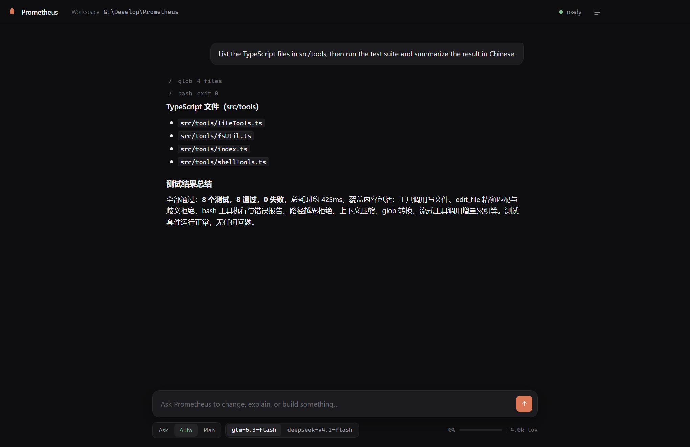

# Prometheus
> 通用终端编程代理 —— 连接任意 OpenAI 兼容接口，在仓库中直接干活。

A general-purpose terminal coding agent, with a desktop app. It talks to any
OpenAI-compatible `/chat/completions` endpoint, streams responses, and works on
your repository through a small, explicit tool set.

```
prometheus "add input validation to src/parser.ts"
npm run desktop          # the same agent in a window
```



## Desktop app

```bash
npm install              # installs Electron
npm run desktop
```

The window opens on the current directory; click the workspace chip to switch
folders. Modes and models sit under the composer, sessions live in the drawer,
and tool calls appear inline with expandable output. Packaging is configured for
electron-builder (`npm run build`) into NSIS/portable, dmg, and AppImage/deb.
See [desktop/README.md](desktop/README.md) for the host protocol.

Pass a folder to a packaged build to open it there:

```bash
Prometheus.exe D:\code\my-project
```

### The window

- **Changes pane.** Every file the agent touched is listed with `+N −N`. Click
  one to open a line diff in the right-hand workbench.
- **History pane.** Each write/edit is checkpointed before it runs; restore one
  step or everything back to the start of the session.
- **Terminal pane.** A persistent shell in the workspace, kept open across
  commands, with its working directory reflected in the prompt.
- **Git bar.** Branch, ahead/behind, and a commit box that stages and commits.
- **`@` references.** Type `@` in the composer to insert a workspace path.
- **Queued messages.** Text sent while a turn is running is delivered at the
  next tool boundary instead of being rejected.
- **Notifications.** Long turns and permission prompts raise a desktop
  notification when the window is not focused.

## What it does

- **Streaming chat with tool use.** The model reads files, edits them, searches
  the tree, and runs shell commands, then loops until the task is done.
- **Three permission modes.** `ask` confirms every mutating tool, `auto` runs
  them but still prompts for destructive shell commands, `plan` only allows
  read-only tools so you can investigate before changing anything.
- **Context that survives long sessions.** A deterministic compaction pass
  replaces old turns with a recap of requests, files touched, and commands run.
- **Sessions.** Every conversation is saved to `~/.prometheus/sessions/` and can
  be resumed with `-r <id>`.
- **Sub-agents.** The `delegate` tool runs a self-contained task in a fresh
  context and returns only the report, keeping the main conversation lean.
- **Memory.** The `remember` tool persists durable facts about you and the
  project; they are injected into the system prompt on the next session.
- **Project instructions.** `PROMETHEUS.md`, `AGENTS.md`, or `CLAUDE.md` in the
  workspace is loaded into the system prompt automatically.
- **Audit log.** Every permission decision is appended to
  `~/.prometheus/audit.log`.
- **Custom commands.** Markdown files in `.prometheus/commands/` become slash
  commands in the composer (see `.prometheus/commands/review.md`).
- **MCP servers.** Stdio servers listed in `~/.prometheus/mcp.json` or
  `<workspace>/.prometheus/mcp.json` contribute their tools to the agent:

  ```json
  { "servers": { "files": { "command": "npx", "args": ["-y", "@modelcontextprotocol/server-filesystem", "."] } } }
  ```

## Requirements

- Node.js 22.6 or newer (uses built-in TypeScript type stripping, so there is no
  build step and no runtime dependencies)
- An OpenAI-compatible endpoint and API key

## Install

```bash
git clone <this repo> prometheus
cd prometheus
npm link          # makes `prometheus` available on PATH
```

Or run it directly without linking:

```bash
node bin/prometheus.js "explain src/context.ts"
```

## Configure

Put the endpoint and key in `~/.prometheus/config.json`:

```json
{
  "baseUrl": "https://api.openai.com/v1",
  "apiKey": "sk-...",
  "model": "glm-5.3-flash"
}
```

Environment variables override the file: `PROMETHEUS_BASE_URL`,
`PROMETHEUS_API_KEY` (or `OPENAI_API_KEY`), `PROMETHEUS_MODEL`. A project can
override settings in `.prometheus/config.json`.

This deployment is allowlisted to the models named in `ALLOWED_MODELS`
(`src/config.ts`): `glm-5.3-flash` and `deepseek-v4.1-flash` by default. Change
`PROMETHEUS_MODELS` to widen the list.

`~/.prometheus/` supports a few more files:

| File                | Purpose                                     |
| ------------------- | ------------------------------------------- |
| `instructions.md`   | Global instructions injected into every run |
| `memory/global.md`  | User-level memory written by `remember`     |
| `memory/<hash>.md`  | Per-project memory                          |
| `audit.log`         | Permission decision log                     |

## Usage

Interactive REPL:

```bash
prometheus
```

One-shot:

```bash
prometheus --mode plan "how does the permission system work?"
prometheus --mode auto "fix the failing test in tests/core.test.ts"
```

| Flag | Meaning |
| --- | --- |
| `-m, --model <name>` | Model id |
| `--base-url <url>` | OpenAI-compatible base URL |
| `--key <key>` | API key |
| `--mode <ask\|auto\|plan>` | Permission mode |
| `-r, --resume <id>` | Resume a saved session |
| `--max-tokens <n>` | Per-response cap (default 16000) |
| `--context-window <n>` | Compaction threshold (default 1,000,000) |
| `--max-turns <n>` | Tool-loop cap per message (default 60) |

### REPL commands

`/help`, `/model [name]`, `/mode [ask|auto|plan]`, `/plan`, `/yolo`, `/clear`,
`/compact`, `/cost`, `/context`, `/sessions`, `/resume <id>`, `/memory`,
`/init`, `/exit`. End a line with `\` to continue it. Esc interrupts a running
turn.

## Tools

| Tool | Purpose |
| --- | --- |
| `read_file` | Numbered lines, with offset/limit and a binary-file guard |
| `write_file` | Create or overwrite a file |
| `edit_file` | Exact-match replacement; refuses ambiguous matches |
| `list_files` | Shallow tree view |
| `glob` | Find files by pattern (`**/*.ts`, brace expansion) |
| `grep` | Content search; uses ripgrep when installed |
| `bash` | Shell commands with timeout and output cap |
| `todo_write` | Maintain the visible task plan |
| `remember` | Persist a durable fact |
| `delegate` | Run a sub-agent and return its report |

All file tools resolve paths and refuse anything outside the workspace (plus
`allowedDirs` from config). Shell commands in `auto` mode still prompt when they
match a destructive pattern (recursive `rm`, `git reset --hard`, `git push
--force`, piping downloads into a shell, and similar).

## Design notes

The runtime is a loop, not a framework: `src/agent.ts` streams one assistant
turn, executes every requested tool call, appends the results, and repeats until
the model stops calling tools. Everything else is a plain module around that
loop.

```
bin/prometheus.js    entry point, CLI parsing, one-shot vs REPL
src/agent.ts         the loop, tool dispatch, sub-agents
src/llm.ts           OpenAI-compatible streaming client
src/permissions.ts   modes, approval prompts, path confinement, audit log
src/context.ts       token estimate and compaction
src/ui.ts            terminal rendering
src/render.ts        markdown-to-terminal formatting
src/tools/           the tool implementations
src/sessions.ts      conversation persistence
src/memory.ts        durable memory files
```

## Development

```bash
npm test        # node --test, includes an end-to-end fake model server
npx tsc --noEmit # type check (requires typescript installed
                 #  separately; the runtime itself needs no dependencies)
```

The tests spin up a local fake `/chat/completions` server, so they run offline
and never spend tokens.

## Hooks

`~/.prometheus/hooks.json` or `<workspace>/.prometheus/hooks.json` can run
local commands around agent activity. Each hook receives a JSON payload on
stdin; a failing `PreToolUse` hook blocks the tool and its output is returned to
the model as the reason.

```json
{
  "hooks": {
    "PreToolUse": [{ "matcher": "^bash$", "command": "./scripts/guard.sh" }],
    "PostToolUse": [{ "command": "npm run lint --silent" }],
    "Stop": [{ "command": "echo turn finished" }]
  }
}
```
